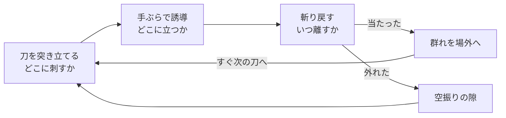

# ヒトフリ

**刀は一本だけ。突き立てて、離れて、斬り戻す。その一本の線が、群れを島の外へ弾き飛ばす。**

見下ろし型の3D剣戟アクション。敵は斬って倒すのではなく、唯一の足場である浮島から落として倒す。

▶ **[unityroom で遊ぶ](https://unityroom.com/games/hitofuri)** 

| ジャンル | 操作 | プレイ時間 | 動作環境 |
| --- | --- | --- | --- |
| 3D見下ろし型アクション(ウェーブ制) | 移動 + ボタン1つ | 1プレイ約5分(全5ウェーブ) + 果てなく(エンドレス) | ブラウザ(WebGL) |

IoA ゲームジャム作品(お題「ひとつだけ」)/ 3人チーム、開発期間1週間


## 遊び方

| 動作 | キーボードとマウス | ゲームパッド | 内容 |
| --- | --- | --- | --- |
| 移動 | WASD | 左スティック | 自由に移動する |
| 突き立てる | 左クリックを押す | Aボタンを押す | その場に刀を置く |
| 誘導する | 押したまま移動 | 押したまま移動 | 手ぶらで速く走り、敵を引きつける |
| 斬り戻す | 離す | 離す | 刀の位置へ戻り、離した地点まで一直線に斬り抜ける |



敵は斬り抜ける向きへ飛ぶ。群れを落とすには、自分が崖っぷちに立つ必要がある。

## 魅力

### 一本の線で、群れをまとめて落とす
刀と自分を結ぶ線がそのまま攻撃範囲。線の中央ほどまっすぐ強く、端ほど横へ弱く飛ぶ。長い線に群れを並べ、縁を背にして斬り戻した一瞬で、まとめて霧の底へ弾き飛ばす。飛んだ敵が別の敵に当たる玉突きも起きる。

### 刀は世界で唯一の光
色を失った世界で、刀だけが光る。突き立てた刀は斬り戻しの起点であり、敵を集める餌であり、罠でもある。

| 敵 | 動き |
| --- | --- |
| 影 | 主人公を追いかける |
| 灯喰らい | 突き立てた刀へ群がる |
| 盾持ち | 主人公へ盾を向ける。正面からは飛ばせない |

「どこに刺し、どこに立つか」を毎回考えさせ、縁で往復するだけの正解を崩す。

### 銘で毎回違う一振りに
落とした数に応じて刀に銘を刻む。数値を積む**小銘**は重ねられ、挙動を変える**大銘**はひとつだけ。

| 大銘 | 効果 |
| --- | --- |
| 残光 | 斬り抜けた線がしばらく残り、触れた敵を押し出す |
| 返し | 斬り抜けた直後、同じ線を逆向きにもう一度斬り抜ける |
| 震 | 斬り抜けて止まった瞬間、周りの敵を外へ押し出す |
| 引力 | 刀を刺した瞬間、周りの敵を刀へ引き寄せる |

### 「一振りで何体」を競う
得点は一振りで落とした数の2乗に比例する。主要な記録は**一振り最多**で、数に応じて「素振り / 一閃 / 断ち / 一刀」の称号が付く。果てなく(エンドレス)は得点で競い、unityroom のランキングに載る。

### 斬り抜けの手応え
線上の敵が多い一振りだけ、カメラがスローから肩越し、終点の定点へと切り替わり、駆け抜ける主人公と飛んでいく群れを見せる。ヒットストップ、縁を越える音、光の粒になって消える落下、大量撃破での画面の色反転で、一振りごとの達成感を積み上げる。

## お題「ひとつだけ」

すべての「ひとつ」は「刀が一本しかない」ことから導いた。どれかを「ふたつ」にすると遊びが壊れることを基準にしている。

| ひとつだけのもの | ふたつにすると何が壊れるか |
| --- | --- |
| 刀 | 手放しても手元に残り、手ぶらの緊張が消える |
| 斬撃の線 | 「一本の線に並べる」誘導が成り立たない |
| 足場(浮島) | 落ちた先にも足場があり、場外で倒す意味が消える |
| 光 | 敵の集まる先が分散し、刀を餌にする戦略が消える |
| 大銘 | 挙動を重ねられ、戦い方を選ぶ悩みが消える |
| ボタン | 操作と「手放す」意味が一致しなくなる |

---

## 技術的な工夫

### 担当をまたいでも直接参照しない設計
3人が並行して書くため、他担当のクラスを参照しない形に統一した。

- **`GameEvents`:** 「刀を刺した」「斬り抜けが当たった」「敵が落ちた」などを C# 標準の `event` で流す。受け手は `OnEnable` で購読し `OnDisable` で解除する
- **`GameContext`:** 途中で湧いた敵も刀の状態などを読めるように、今の状態を置く。書くのは持ち主だけで、他は読むだけ
- **`ILaunchable`:** 主人公側は敵の種類を知らずに、この口だけで吹き飛ばす。大銘「震」「残光」も同じ口を使う

### 物理エンジンに任せない吹き飛び
Rigidbody に力を加えず、初速と摩擦で軌道を自前で動かす。飛び方そのものを手触りとして調整するため。

- 線上の当たった位置(中央ほど前、端ほど横)と、線の長さ、光の蓄積から初速を計算し、敵の重さ(`Weight`)を掛ける(`SlashResolver`)
- 主人公が敵の位置を通り過ぎた瞬間に飛ばし、斬り抜けて吹き飛ぶ順番を見せる
- 玉突きは飛んでいる敵の体の形をフレーム間で掃引して判定し、当てた敵の一振りIDを引き継いで同じ一振りとして数える(`TamatsukiResolver`)

### 時間制御の一元化
`Time.timeScale` を書き換えるのは `TimeController` だけ。ポーズ、銘の選択、ヒットストップ、斬り抜けのスローが重なっても「停止 > ヒットストップ > スロー」の優先度でまとめ、演出同士がぶつからない。UI は unscaled time で動かす。

### 斬り抜け演出カメラ
Cinemachine で、見下ろしからスロー、肩越しの追従、終点の定点カメラへハードカットする(`SlashCinematic`)。テンポを崩さないよう、線上の敵が多い一振りだけで発動し、演出中と視点が戻った直後は被弾させない。

### 銘の倍率を一か所で合成
小銘の段数を足し算し、能力ごとの上限で切った最終倍率を `GameContext.MeiStats` で配る(`MeiState`)。各担当は自分の基本値に倍率を掛けるだけで、銘の計算を各所に散らさない。

### 調整値を担当ごとの ScriptableObject に分離
`PlayerTuning`、`EnemyTuning`、`FeedbackTuning`、`MeiTuning` に分け、コードにマジックナンバーを置かない。手触りの調整を並行して進めても、互いのファイルを触らずに済む。

### 理不尽さを減らす出現と視認性
敵の出現位置を先に予約して予兆を出してから湧かせ(`EnemySpawner`)、画面外の敵はアイコンで示す。不意打ちの被弾を減らし、読み合いに集中させる。

### WebGL 向けの選択
- エフェクトは VFX Graph ではなく Particle System
- UniTask はスレッド切り替えを使わず、メインスレッドだけで動かす
- 自己ベストは PlayerPrefs でブラウザに保存し、果てなくの得点は unityroom のランキングへ送信

## 使用技術

Unity 6.3 LTS(URP)/ Input System / Cinemachine / UniTask / uGUI + TextMeshPro / Particle System

## フォルダ構成

```
Assets/_Project/Scripts/
  Shared/    基盤コード(GameEvents、GameContext、TimeController など)
  Player/    主人公、斬り戻し、吹き飛ばしの計算、カメラ
  Enemy/     敵の追跡、攻撃、吹き飛びの軌道
  Game/      ウェーブ、出現、ゲーム進行
  Mei/       銘
  Feedback/  揺れ、SE、エフェクト
  UI/        画面、HUD、記録、ランキング
Documents/   企画書、仕様書、チーム連携ガイド
```

## 開発チーム

| 名前 | 担当 |
| --- | --- |
| 髙橋 | 主人公の操作、斬り戻し、吹き飛ばしの計算、カメラ、時間制御、基盤コード |
| 三條 | 敵、ウェーブ、ゲーム進行 |
| 増永 | 銘、演出、UI |

## クレジット

- フォント: しっぽり明朝 B1(SIL Open Font License、[Documents/ShipporiMinchoB1-OFL.txt](Documents/ShipporiMinchoB1-OFL.txt))
<!-- TODO: その他の外部アセット(モデル、アニメーション、SE、BGM)のクレジットを追記する -->
